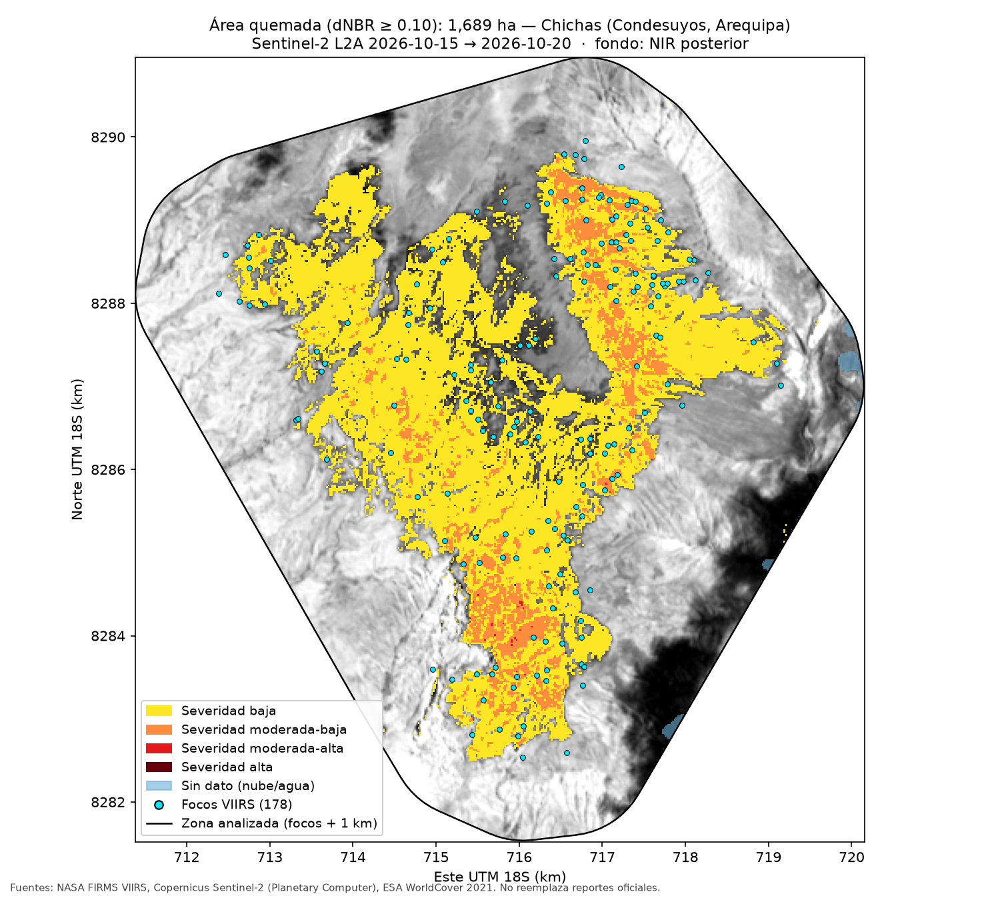
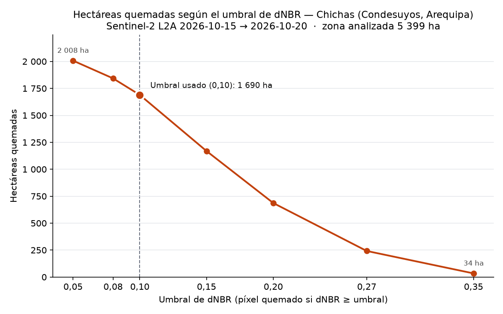
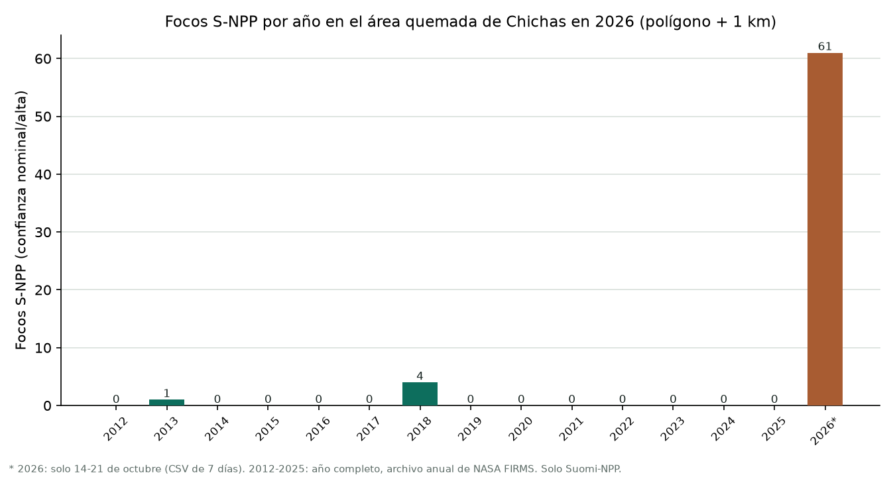

# Incendios Perú

## Pregunta

¿Cuántas hectáreas se quemaron en el incendio de Chichas (Condesuyos, Arequipa), 16-18 de octubre de 2026 y qué tipo de suelo era?

## Datos y fechas

- Focos VIIRS (Suomi-NPP, NOAA-20, NOAA-21), CSV "South America 7d" de NASA FIRMS,
  descargado el 21-oct-2026 (focos del 14 al 21-oct). Solo confianza nominal/alta.
- Límites distritales: GADM 4.1, nivel 3.
- Sentinel-2 L2A, tile 18LYH: ANTES 15-oct-2026 (0.0 % nube en la zona),
  DESPUÉS 20-oct-2026 (0.2 % nube en la zona).
- ESA WorldCover 2021 (v2.0.0), vía Microsoft Planetary Computer.
- Se eligió primero Callería (Ucayali), pero no había imagen Sentinel-2 posterior
  al fuego (17-21 oct); por regla fija se pasó a Chichas.
- Zona analizada: envolvente de los 178 focos + 1 km (5 399 ha), rejilla de 20 m.

## Método

- Focos de calor VIIRS de NASA FIRMS.
- Imágenes Sentinel-2 L2A.
- dNBR (diferencia del índice NBR antes/después) con máscara de nubes SCL.
- Cruce con ESA WorldCover para identificar la cobertura del suelo.

## Tres hallazgos

1. Se quemaron 1 690 ha (dNBR ≥ 0,10), el 31 % de las 5 399 ha analizadas.
2. El 72,4 % de lo quemado era pastizal; bosque, 0,1 ha; cultivo, cero.
3. La medición da 43 % menos que lo que sugerían los focos, cuya envolvente apuntaba a 2 957 ha.

La historia completa está en la página [index.html](index.html)
(publicada en https://gabriela-pozo.github.io/incendios-peru/ cuando se active GitHub Pages).

Tablas: `outputs/severidad_chichas.csv`, `outputs/cobertura_quemada_chichas.csv`
(y `_detalle.csv`), `outputs/imagenes_chichas.csv`, `outputs/top5_incendios.csv`.

## Mapa

## Sensibilidad al umbral

| Umbral dNBR | Hectáreas quemadas | % de la zona |
|---|---:|---:|
| 0,05 | 2 007,5 | 37,2 |
| 0,08 | 1 842,9 | 34,1 |
| **0,10 (usado)** | **1 689,5** | **31,3** |
| 0,15 | 1 168,9 | 21,6 |
| 0,20 | 686,6 | 12,7 |
| 0,27 | 241,9 | 4,5 |
| 0,35 | 33,9 | 0,6 |

- Con el corte estándar de 0,10 el área quemada es de 1 690 ha.
- La cifra es muy elástica: de 2 008 ha a 34 ha entre 0,05 y 0,35, un factor de 59.
- La razón es que el incendio fue de baja severidad y sus píxeles se concentran
  cerca del umbral. Si hubiera sido un incendio forestal intenso, la curva sería plana.
- La escala de Key y Benson se calibró sobre incendios forestales; en pastizal casi
  todo cae en la banda baja y la elección del umbral pesa más que el fuego.
- 34-2 008 ha **no** es "el rango del incendio": con 0,05 se recogen ruido y cambios
  que no son fuego, y con 0,35 solo los núcleos más calientes.

Tabla: `outputs/sensibilidad_umbral_chichas.csv`.

## Recurrencia interanual

¿El área que ardió en 2026 arde cada año o fue excepcional? Se contaron los focos
de Suomi-NPP (confianza nominal/alta) de cada año 2012-2025, del archivo anual de
NASA FIRMS para Perú, dentro del polígono quemado en 2026 (1 689,5 ha, dNBR ≥ 0,10)
y dentro del polígono + 1 km (5 855,2 ha). Solo S-NPP: sumar NOAA-20 (desde 2018)
y NOAA-21 (desde 2023) inflaría los años recientes.

| Año | Focos en el polígono | Focos en polígono + 1 km | Días con datos (Perú) |
|---|---:|---:|---:|
| 2012 | 0 | 0 | 346 |
| 2013 | 0 | 1 | 365 |
| 2014 | 0 | 0 | 363 |
| 2015 | 0 | 0 | 365 |
| 2016 | 0 | 0 | 365 |
| 2017 | 0 | 0 | 364 |
| 2018 | 0 | 4 | 365 |
| 2019 | 0 | 0 | 364 |
| 2020 | 0 | 0 | 366 |
| 2021 | 0 | 0 | 365 |
| 2022 | 0 | 0 | 350 |
| 2023 | 0 | 0 | 363 |
| 2024 | 0 | 0 | 346 |
| 2025 | 0 | 0 | 362 |
| 2026* | 44 | 61 | 8 |

\* 2026: solo 14-21 de octubre (CSV de 7 días); el archivo anual 2026 aún no existe.

- **Los datos apuntan a un evento excepcional.** En 14 años completos, cero focos
  dentro del polígono. En el anillo de 1 km, focos en solo 2 años: 1 en marzo de 2013
  y 4 en diciembre de 2018. En 2026, en dos días (17 y 18 oct), 44 dentro y 61 con el anillo.
- **Confianza.** Los 14 años tienen datos utilizables (detecciones en el Perú en 346
  a 366 días de cada año). Confianza alta en que entre 2012 y 2025 no hubo ahí un
  incendio del tamaño del de 2026 (que dio 61 focos en dos días). Confianza baja en
  que la zona nunca se queme: S-NPP pasa unas dos veces al día y una quema de pastos
  pequeña y rápida puede ocurrir entre dos pasadas. Incluir los focos de confianza
  baja no cambia el resultado: siguen siendo cero dentro del polígono.
- **Lectura económica.** Una recurrencia alta habría sugerido quema de manejo de
  pastos (práctica productiva con externalidades: humo, emisiones, riesgo de escape).
  La recurrencia nula es más compatible con un evento excepcional, es decir, con un
  daño: forraje perdido sin haberlo planeado. Es evidencia compatible, no prueba:
  las quemas pequeñas pueden escapar al satélite, y un evento excepcional también
  puede ser una quema de manejo que se salió de control.

Tablas: `outputs/recurrencia_chichas.csv`, `outputs/focos_historicos_chichas.csv`;
polígono: `outputs/poligono_quemado_chichas.geojson`.

## Segundo caso, amazónico: Río Tambo (no medible)

Se intentó medir Río Tambo (Satipo, Junín), el incendio con más focos de la semana
(279 focos del 14 al 17 de octubre, el 99,6 % sobre bosque), con exactamente el mismo
método: zona de focos + 1 km (5 530 ha), umbral 0,10, máscara SCL, WorldCover y curva
de sensibilidad. Hay buena imagen anterior (8-oct-2026, tile 18LXM, 0,0 % de la zona
inválida), pero **ninguna posterior utilizable**; la regla exige como máximo el 30 %
de la zona inválida:

| Imagen posterior | Tile | Nubes en la zona | Zona inválida |
|---|---|---:|---:|
| 18-oct-2026 | 18LXM | 85,6 % | 85,6 % |
| 18-oct-2026 | 18LXN | 59,1 % | 96,0 % |
| 20-oct-2026 (la mejor) | 18LXM | 55,4 % | 55,4 % |
| 20-oct-2026 | 18LXN | 44,8 % | 81,7 % |

No se forzó la medición con la mitad sin nubes, porque la cifra no sería comparable
con la de Chichas. Es el mismo problema que dejó fuera a Callería. En la Amazonía,
octubre es el pico de la temporada de quemas y también el inicio de las lluvias: la
nubosidad impide medir justo cuando más arde, y eso sesga el análisis óptico hacia
los incendios andinos.

**La hipótesis queda sin contrastar.** Se esperaba que en bosque la severidad saliera
alta y la curva plana, y que en pastizal saliera baja y la curva empinada. Chichas es
compatible con la mitad de pastizal (85,7 % de lo quemado en severidad baja, factor de
59 entre umbrales), pero sin un caso de bosque un solo caso no respalda ni refuta la
hipótesis.

Tabla: `outputs/imagenes_riotambo.csv`.

## Limitaciones

- Un foco de calor es un píxel de 375 m donde un satélite detectó fuego, incluidas
  quemas agrícolas. No es un incendio y no es una hectárea.
- La cifra de hectáreas depende de cuatro decisiones: fechas, nubes, umbral y zona.
  Solo el umbral la mueve entre 34 y 2 008 ha (ver "Sensibilidad al umbral").
- VIIRS no detecta de forma confiable incendios pequeños, bajo dosel cerrado o
  cubiertos por nubes.
- Un solo caso medido: los dos candidatos amazónicos (Callería y Río Tambo) no
  tenían imagen posterior sin nubes, así que no hay contraste entre bosque y pastizal.
- WorldCover es de 2021, así que la cobertura pudo cambiar antes del incendio.
- Herramienta independiente con datos públicos; no reemplaza los reportes del
  COEN, INDECI, SERFOR ni SERNANP.
