# Lo que no se puede medir

Intentamos medir el área quemada de los veinte incendios más grandes del Perú. Lo conseguimos con cuatro. Ese fracaso, y no las hectáreas, es el resultado.

Gabriela Pozo · Reto C. La historia completa está en [index.html](index.html) (publicada en
https://gabriela-pozo.github.io/incendios-peru/ cuando se active GitHub Pages).

## 1. El resultado principal: el 80 % no era medible

Sobre cada uno de los 20 incendios con más focos de calor entre el 14 y el 21 de octubre de 2026 se
corrió exactamente el mismo procedimiento (par Sentinel-2 antes y después, máscara de nubes, dNBR y
cruce con WorldCover). La regla para aceptar una imagen se fijó antes de mirar los datos: como máximo
el 30 % de la zona tapada.

- **4 de 20** incendios medidos: tasa de éxito del 20 %.
- **13** descartados por nubes sobre la zona; 2 sin ninguna pasada de Sentinel-2 y 1 por el prefiltro.
- **p = 0,62**: sin diferencia significativa entre Andes y Amazonía.

> El sesgo no es geográfico sino de calendario. En la Amazonía se midió el 12,5 % de los incendios y en los Andes el 25,0 %, una diferencia que la prueba exacta de Fisher no distingue del azar (p = 0,62). En octubre empieza la temporada de lluvias en ambas regiones. La consecuencia es incómoda: la temporada de fuego coincide con la temporada en que no se ve el suelo, así que cualquier indicador nacional de área quemada en tiempo casi real mide solo el subconjunto de incendios que las nubes dejaron pasar.

| Incendio | Región | Focos | Envolvente (ha) | Quemado (ha) | Resultado |
|---|---|---:|---:|---:|---|
| **Chichas** (Arequipa) | Andes | 178 | 2 957 | **1 689,5** | Medido · pastizal |
| **Iparía** (Ucayali) | Amazonía | 108 | 724 | **255,4** | Medido · bosque |
| **San Cristóbal** (Moquegua) | Andes | 59 | 587 | **609,9** | Medido · pastizal |
| **Curahuasi** (Apurímac) | Andes | 45 | 475 | **306,0** | Medido · pastizal |
| Río Tambo (Junín) | Amazonía | 279 | 3 051 | — | Nubes sobre la zona (55,4 % de la zona inválida) |
| Curahuasi (Apurímac) | Andes | 201 | 3 227 | — | Sin pasada de Sentinel-2 |
| Callería (Ucayali) | Amazonía | 116 | 1 530 | — | Nubes sobre la zona (47,2 % de la zona inválida) |
| Huanoquite (Cusco) | Andes | 80 | 1 220 | — | Nubes sobre la zona (100,0 % de la zona inválida) |
| Nueva Requena (Ucayali) | Amazonía | 65 | 416 | — | Nubes sobre la zona (77,7 % de la zona inválida) |
| Cayna (Huánuco) | Andes | 63 | 724 | — | Nubes sobre la zona (100,0 % de la zona inválida) |
| Mazamari (Junín) | Amazonía | 62 | 793 | — | Sin pasada de Sentinel-2 |
| Palca (Junín) | Andes | 61 | 853 | — | Nubes sobre la zona (100,0 % de la zona inválida) |
| Santa Cruz (Loreto) | Amazonía | 50 | 560 | — | Nubes sobre la zona (100,0 % de la zona inválida) |
| Nueva Requena (Ucayali) | Amazonía | 49 | 315 | — | Descartada por el prefiltro (18,2 % de la zona inválida) |
| Nueva Requena (Ucayali) | Amazonía | 48 | 308 | — | Nubes sobre la zona (100,0 % de la zona inválida) |
| San Juan de Jarpa (Junín) | Andes | 42 | 497 | — | Nubes sobre la zona (89,4 % de la zona inválida) |
| Caja (Huancavelica) | Andes | 39 | 181 | — | Nubes sobre la zona (47,5 % de la zona inválida) |
| Ayahuanco (Ayacucho) | Andes | 39 | 400 | — | Nubes sobre la zona (55,1 % de la zona inválida) |
| Ancahuasi (Cusco) | Andes | 36 | 259 | — | Nubes sobre la zona (65,7 % de la zona inválida) |
| San Miguel (Ayacucho) | Andes | 35 | 264 | — | Nubes sobre la zona (63,7 % de la zona inválida) |

Nueva Requena (Ucayali, 49 focos): la zona estaba limpia en un 81,8 %, pero el pipeline descarta de entrada las escenas con más del 80 % de nubes en la escena completa. Es un caso medible perdido por una decisión propia. No se corrigió para no cambiar el método a mitad del análisis.

Se excluyó un grupo de focos en Paracas (Ica, 42 focos en 49 ha) con un criterio escrito y aplicado a los 40 primeros candidatos: no es un incendio si más de la mitad de las detecciones S-NPP de 2012-2025 en su zona son de tipo 2 en FIRMS (fuente estática terrestre, como una planta industrial). En Paracas lo son 3 770 de 3 838 (98,2 %), detectadas en 2 139 días distintos; en los demás candidatos, ninguna. Su lugar lo ocupa San Miguel (Ayacucho), el siguiente por número de focos.

**Los cuatro que sí se pudieron medir** (mismo método y escala de colores):

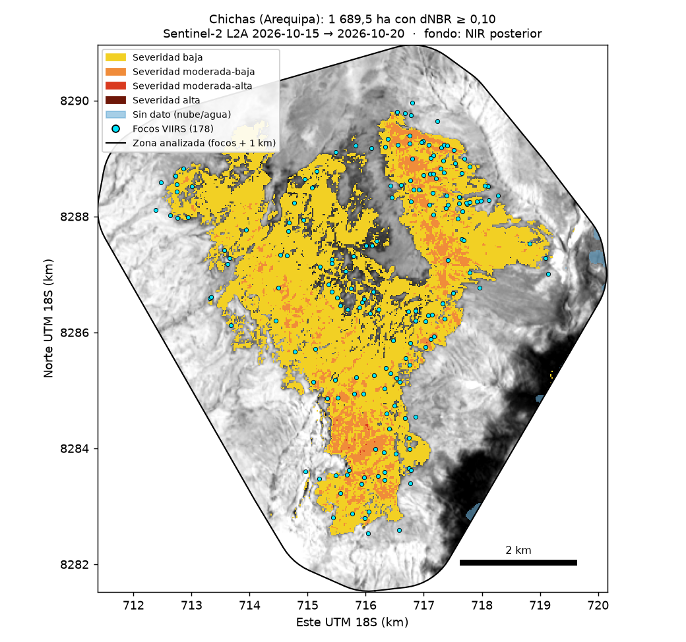
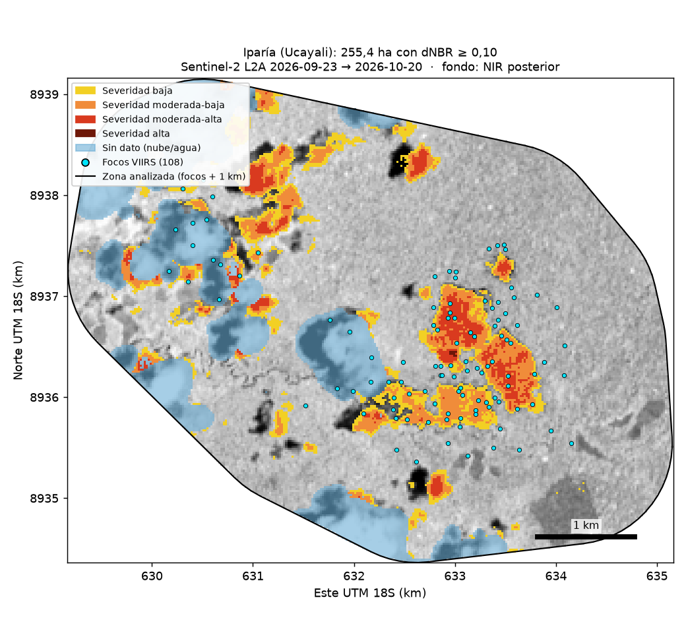
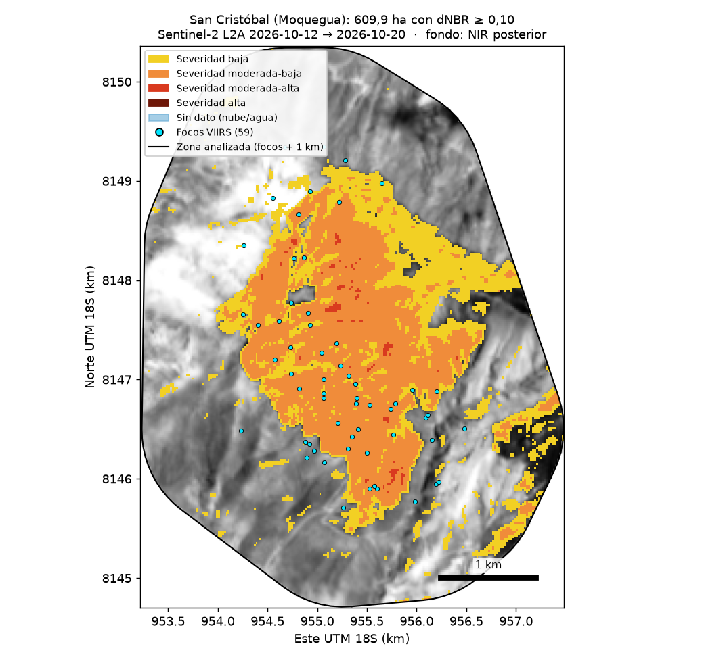
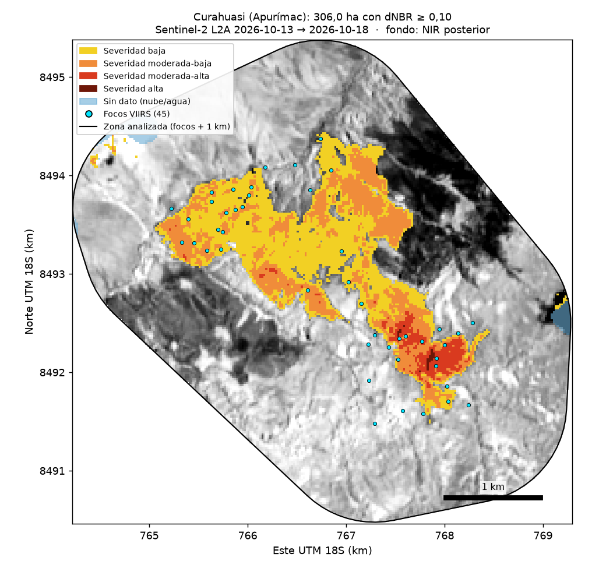

Tablas: `outputs/medicion_top20.csv`, `outputs/top20_exito_region.csv`, `outputs/top20_pruebas.csv`,
`outputs/fuentes_estaticas_candidatos.csv`.

## 2. El mapa nacional y cómo se comporta el fuego

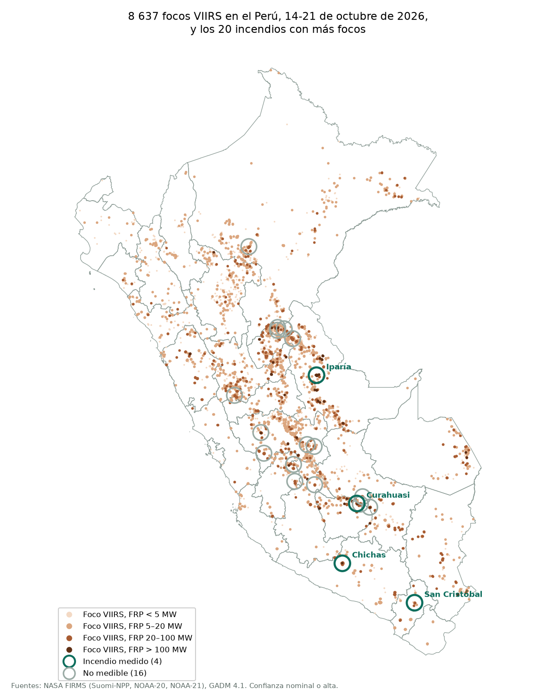

- 79,9 % de los 8 637 focos fue diurno.
- 89,5 % de los 2 602 incendios duró menos de 12 h entre su primer y su último foco.
- FRP mediana por foco: 6,55 MW.
- Solo 11 de 2 602 incendios superaron los 3 días.

VIIRS detecta mejor de noche, cuando el suelo está frío y el contraste térmico es mayor, así que el
predominio diurno no se explica por el sensor. 1 345 incendios
tienen un solo foco (duración cero): la duración mide el tiempo entre la primera y la última detección.

Tabla: `outputs/comportamiento_nacional.csv`.

## 3. El caso medido: Chichas, 1 690 ha donde nunca había ardido


Sentinel-2 en color real, mismo recorte y ajuste de color: 2026-10-15 (izquierda) y 2026-10-20 (derecha). Las manchas blancas y oscuras abajo a la derecha del 2026-10-20 son nubes y sus sombras.

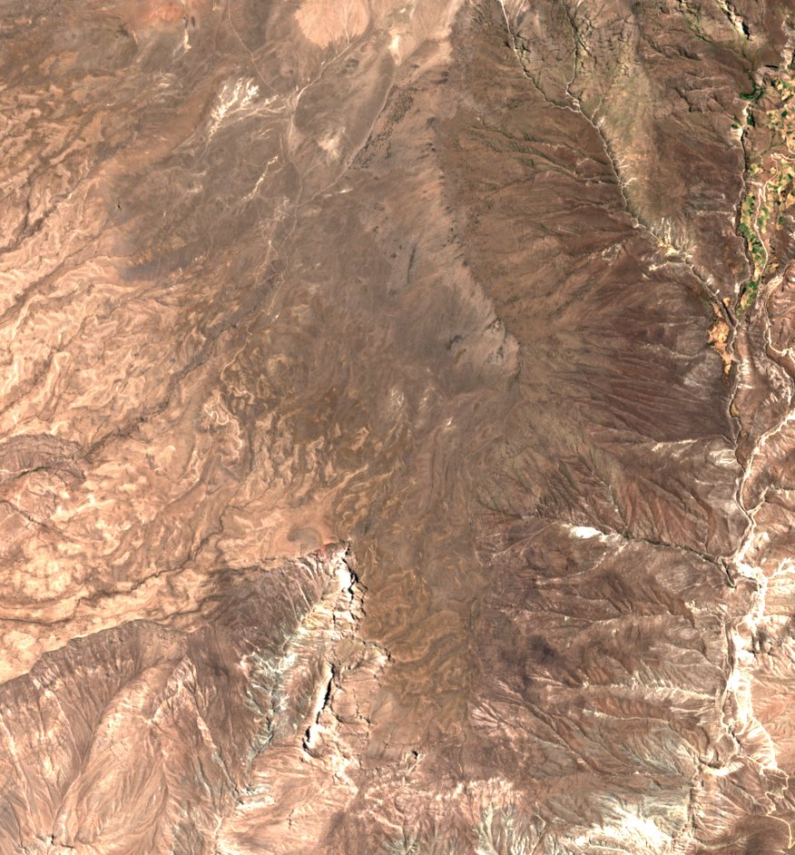 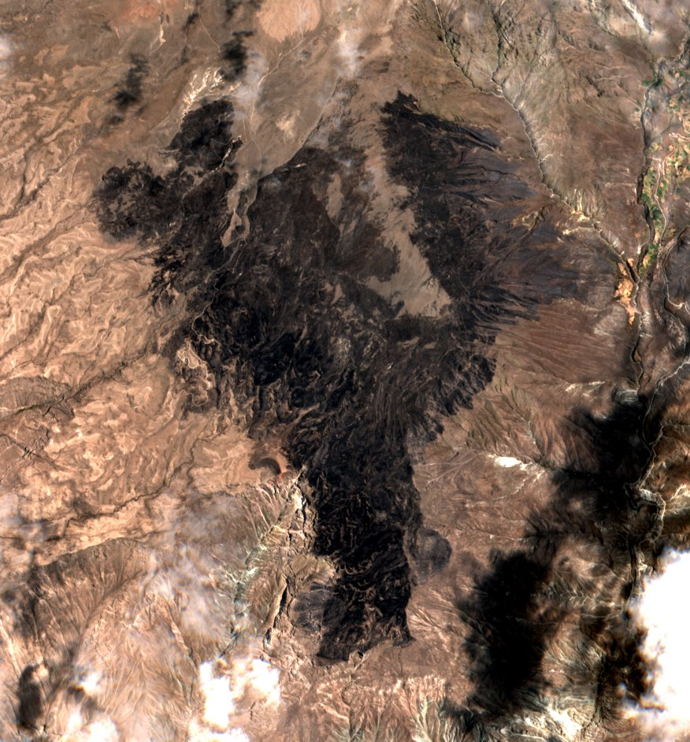

- **1 690 ha** quemadas (dNBR ≥ 0,10), el 31 % de las 5 399 ha analizadas.
- **4,3 %** del distrito de Chichas (38 976 ha según los límites GADM 4.1).
- **0** focos dentro del área quemada entre 2012 y 2025.


Entre 2012 y 2025, con entre 346 y 366 días de registro al año, el área que ardió en 2026
no registró **ni un solo foco**. En el anillo de 1 km hubo uno en 2013 y cuatro en 2018. En los ocho días de registro de
octubre de 2026 hubo 44 focos dentro y 61 contando el anillo.

**Queda descartada una quema de manejo recurrente**: una zona de quema habitual aparece en el registro
año tras año, y esta no aparece nunca. La salvedad es de escala: una quema muy pequeña o muy rápida
puede ocurrir entre dos pasadas del satélite sin dejar foco.

El 56,7 % de los focos de Chichas fue nocturno: la tercera firma más
nocturna de los veinte, en un país donde el 79,9 % fue diurno.

Tablas: `outputs/recurrencia_chichas.csv`, `outputs/recurrencia_noche_chichas.csv`,
`outputs/severidad_chichas.csv`, `outputs/poligono_quemado_chichas.geojson`.

## 4. Reto C: qué tipo de suelo ardió

| Cobertura (WorldCover 2021) | Hectáreas | % de lo quemado |
|---|---:|---:|
| Pastizal | 1 223,0 | 72,4 % |
| Matorral | 455,6 | 27,0 % |
| Suelo desnudo | 10,3 | 0,6 % |
| Agua | 0,4 | 0,0 % |
| Bosque | 0,1 | 0,0 % |
| Cultivo | 0,0 | 0,0 % |
| **Total** | **1 689,4** | 100 % |

**Cero hectáreas de cultivo y una décima de bosque.** El daño es pérdida de forraje y el afectado es la
ganadería extensiva. Con recurrencia nula, además, no es forraje que se queme en un ciclo de manejo.

Tabla: `outputs/cobertura_quemada_chichas_detalle.csv`.

## 5. Tres hipótesis que cayeron

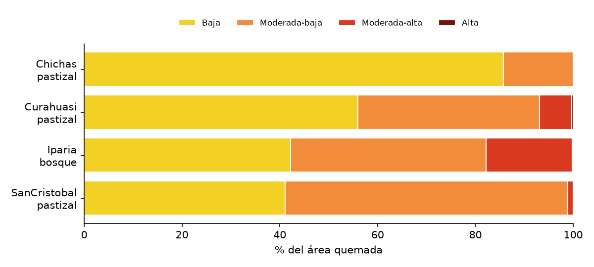

| Incendio | Región | Cobertura | Quemado (ha) | Severidad baja | Moderada o más | Medida vs envolvente |
|---|---|---|---:|---:|---:|---:|
| Chichas | Andes | pastizal | 1 689,5 | 85,7 % | 14,4 % | −42,9 % |
| Iparía | Amazonía | bosque | 255,4 | 42,2 % | 57,7 % | −64,7 % |
| San Cristóbal | Andes | pastizal | 609,9 | 41,1 % | 58,9 % | +3,9 % |
| Curahuasi | Andes | pastizal | 306,0 | 56,0 % | 44,0 % | −35,6 % |

**a) "En pastizal la severidad sale baja y en bosque alta": no se sostiene.** Los pastizales van del
14,4 % al 58,9 % de severidad moderada o superior, y el único bosque medible,
Iparía, cae dentro de ese rango con 57,7 %. Chichas es el atípico. Con n = 4 no se
puede concluir que la escala de Key y Benson esté mal calibrada para el pastizal andino, y no
encontramos ningún estudio de dNBR con validación de campo en puna o páramo: ese vacío es en sí mismo
un hallazgo.

**b) "Los focos sobrestiman de forma sistemática": no.** −64,7 % en Iparía,
−42,9 % en Chichas, −35,6 % en Curahuasi y +3,9 % en San Cristóbal. Tres sobrestiman y uno
subestima, en un rango demasiado amplio para un factor de corrección. Lo que queda en pie es que contar
focos no mide hectáreas.

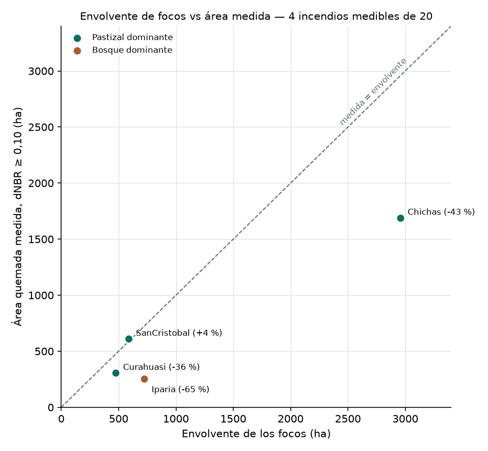

**c) "Las nubes castigan sobre todo a la Amazonía": no** (Fisher, p = 0,62).

| Región | Incendios | Medidos | % medidos | Nubes | Sin pasada | Prefiltro |
|---|---:|---:|---:|---:|---:|---:|
| Amazonía | 8 | 1 | 12,5 % | 5 | 1 | 1 |
| Andes | 12 | 3 | 25,0 % | 8 | 1 | 0 |

Tablas: `outputs/top20_medidos_resumen.csv`, `outputs/top20_pruebas.csv`.

## 6. Robustez

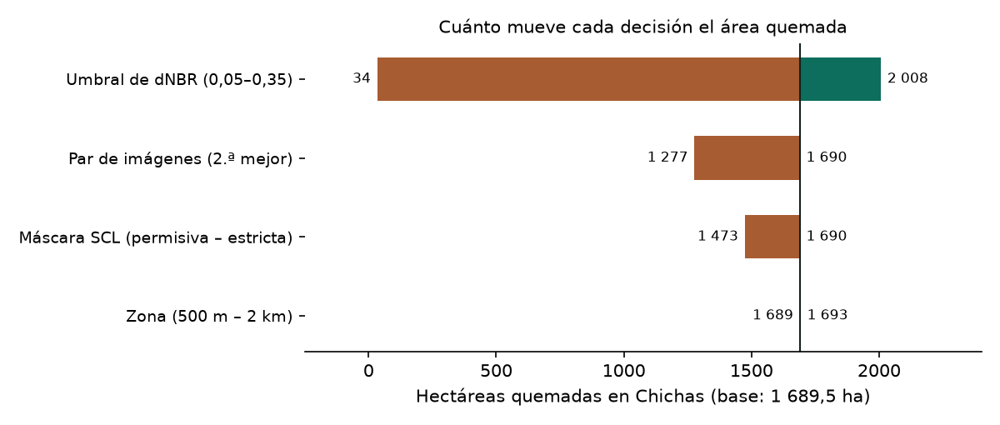

| Decisión | Mínimo (ha) | Máximo (ha) | Recorrido (ha) |
|---|---:|---:|---:|
| Umbral de dNBR (0,05–0,35) | 33,9 | 2 007,5 | 1 973,6 |
| Par de imágenes (2.ª mejor) | 1 276,7 | 1 689,5 | 412,8 |
| Máscara SCL (permisiva – estricta) | 1 473,4 | 1 689,5 | 216,1 |
| Zona (500 m – 2 km) | 1 688,9 | 1 693,1 | 4,2 |

El umbral solo mueve 3,1 veces más que las otras tres decisiones juntas (633,1 ha).


| Umbral dNBR | Hectáreas | % de la zona |
|---|---:|---:|
| 0,05 | 2 007,5 | 37,2 % |
| 0,08 | 1 842,9 | 34,1 % |
| **0,10 (usado)** | 1 689,5 | 31,3 % |
| 0,15 | 1 168,9 | 21,6 % |
| 0,20 | 686,6 | 12,7 % |
| 0,27 | 241,9 | 4,5 % |
| 0,35 | 33,9 | 0,6 % |

La curva colapsa rápido porque los píxeles quemados se apiñan cerca del umbral. Con 0,35, a Chichas le
queda el 2 % del área medida con 0,10; a Iparía, el 39 %.

> **Más rigor aparente, menos señal.** Endurecer la máscara de nubes *reduce* el área en
> 216,1 ha, pero no porque quite nubes: la capa SCL de Sentinel-2 clasifica
> 178,7 ha de la propia cicatriz como "zona oscura" y
> 37,4 ha como "sin clasificar", y la máscara estricta las descarta.

Tablas: `outputs/tornado_chichas.csv`, `outputs/robustez_chichas.csv`, `outputs/robustez_diagnostico.csv`,
`outputs/sensibilidad_umbral_chichas.csv`.

## 7. Validación contra MCD64A1

MCD64A1 aún no existe para octubre de 2026, así que se validó el método en incendios de 2024 con una
regla fijada antes de ver resultados (los 3 primeros medibles por número de focos; como robustez, los
21 candidatos medibles).

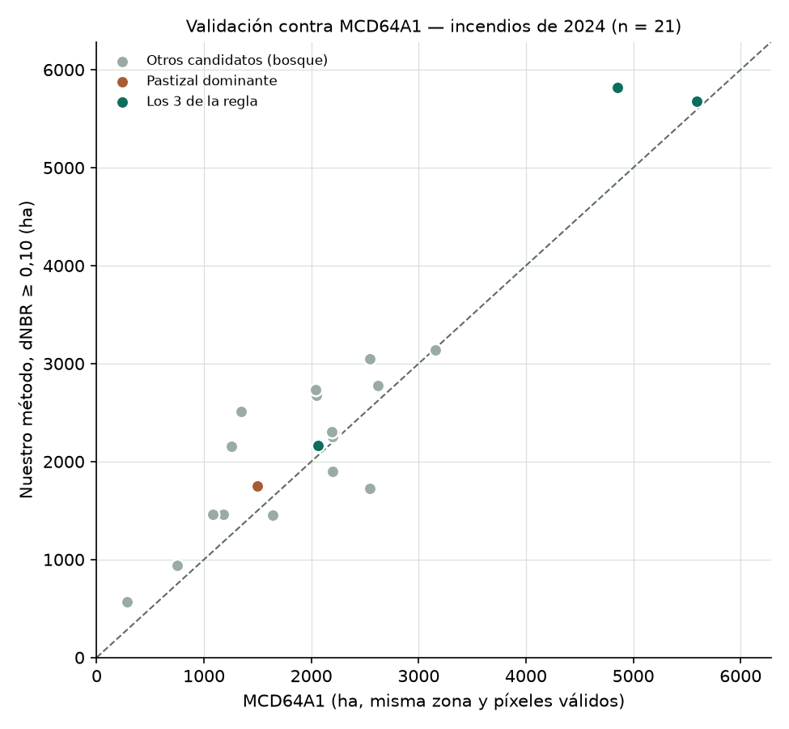

| Muestra | n | Razón mediana (nuestro / MCD64A1) | Rango | Chichas corregida (ha) |
|---|---:|---:|---:|---:|
| 3 casos (regla fijada) | 3 | 1,048 | 1,016-1,198 | 1 612 |
| 21 candidatos medibles | 21 | 1,171 | 0,678-2,018 | 1 443 |
| solo pastizal dominante | 1 | 1,171 | 1,171-1,171 | 1 443 |

**La cifra principal sigue siendo 1 690 ha**; las corregidas son alternativas: la validación es casi
toda bosque amazónico y el caso es pastizal andino; MCD64A1 usa píxeles de 500 m y es otra estimación
satelital, no un dato de campo; y varios de los 21 candidatos se solapan y no son independientes.

Tablas: `outputs/validacion_resumen.csv`, `outputs/validacion_mcd64a1.csv`, `outputs/validacion_candidatos.csv`.

## 8. Concentración y MAUP

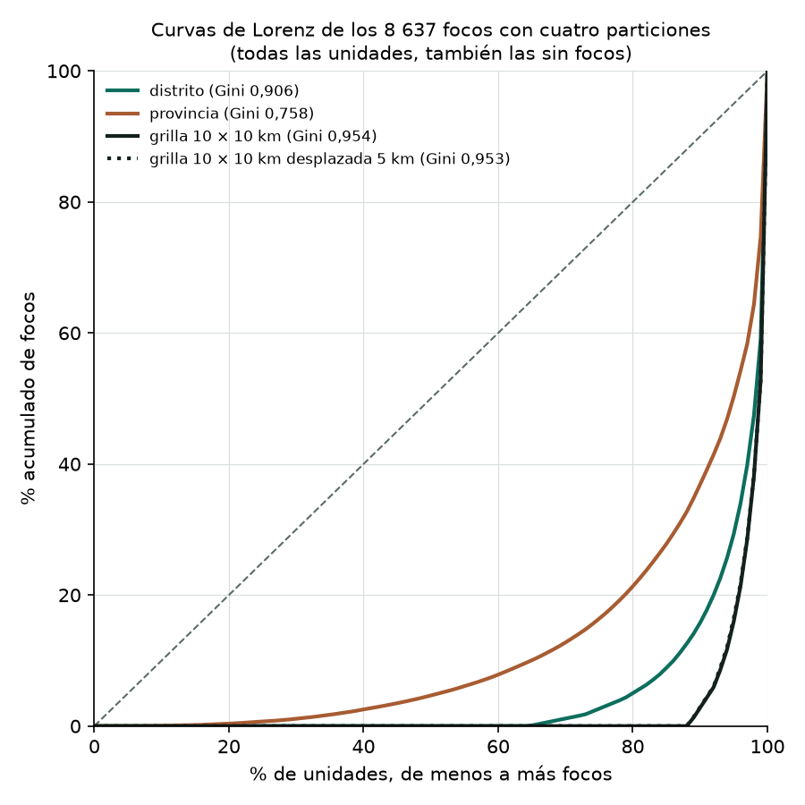

| Partición | Unidades con focos | Gini (solo con focos) | Gini (todas) |
|---|---:|---:|---:|
| distrito | 644 de 1 815 | 0,735 | 0,906 |
| provincia | 180 de 195 | 0,737 | 0,758 |
| grilla 10 × 10 km | 1 588 de 13 464 | 0,609 | 0,954 |
| grilla 10 × 10 km desplazada 5 km | 1 595 de 13 453 | 0,607 | 0,953 |

El Gini va de 0,607 a 0,954 según la unidad y según si se cuentan las unidades sin fuego.
Cualquier índice de concentración que no declare su unidad no significa nada; lo robusto es que la
distribución es muy desigual en las cuatro particiones.

Tablas: `outputs/gini_maup.csv`, `outputs/lorenz_maup.csv`.

## 9. Implicaciones

- No se puede construir un indicador nacional de área quemada en tiempo casi real para el Perú en
  octubre: con 4 de 20, lo que se reporta es una muestra sesgada.
- Las hectáreas no son comparables entre estudios si no declaran el umbral: en Chichas, solo el umbral
  las mueve 1 973,6 ha.
- Endurecer la máscara puede empeorar la medición.
- Contar focos no mide daño: la desviación frente al área medida va de −64,7 % a +3,9 %.
- El gasto parece rendir más en prevención que en combate: solo 11 de 2 602 incendios superaron los 3 días.
- Un índice de concentración exige declarar su unidad espacial.

## 10. Qué haría falta para ponerle precio

- **Capacidad de carga** del pastizal quemado.
- **Tiempo de recuperación del forraje.**
- **Hogares y cabezas de ganado dependientes.**
- **Intencionalidad.** Esta sí se pudo acotar en parte: con recurrencia cero queda descartada la quema rutinaria.

La teledetección acota qué y cuánto se quemó, pero no determina si fue una pérdida.

## 11. Método

1. **Focos**: VIIRS de NASA FIRMS (Suomi-NPP, NOAA-20 y NOAA-21, CSV de 7 días descargado el 21-oct-2026),
   confianza nominal o alta, filtrados a Perú con GADM 4.1.
2. **Incendios**: dos focos son del mismo incendio si están a ≤ 1 km y ≤ 48 h entre sí.
3. **Par de imágenes**: Sentinel-2 L2A (Microsoft Planetary Computer), la de menos zona inválida antes y después.
4. **dNBR y severidad**: NBR = (B8A − B12)/(B8A + B12); dNBR = NBR antes − NBR después; clases de Key y Benson.
5. **Cobertura**: ESA WorldCover 2021 cruzado con los píxeles quemados.
6. **Contraste**: recurrencia con el archivo anual S-NPP 2012-2025, sensibilidad a cada decisión y validación contra MCD64A1.

| Imagen | Fecha | Tile | Nubes en la zona | Nubes en la escena |
|---|---|---|---:|---:|
| Antes | 2026-10-15 | 18LYH | 0,0 % | 0,3 % |
| Después | 2026-10-20 | 18LYH | 0,2 % | 11,4 % |

Decisiones declaradas: umbral dNBR ≥ 0,10; máscara SCL (sombra, nube media, nube alta, cirros, agua y
sin dato); zona = focos + 1 km = 5 399 ha en Chichas, rejilla de 20 m; recurrencia solo con S-NPP,
el único con registro continuo desde 2012.

## 12. Limitaciones y qué no se pudo hacer

- n = 4: ninguna comparación entre incendios medidos tiene potencia estadística.
- Un foco no es un incendio ni una hectárea: es un píxel de 375 m donde un satélite detectó calor.
- La validación no cubre el bioma del caso: casi toda es bosque amazónico, contra un producto de 500 m.
- La firma diurna no prueba intencionalidad.
- El prefiltro descartó al menos un caso medible (Nueva Requena).
- Paracas se excluyó como fuente estática con el criterio escrito de la sección 1; con otro criterio el top 20 cambiaría.
- Una semana no es una temporada.
- WorldCover es de 2021: la cobertura pudo cambiar antes del incendio.
- Las cifras oficiales no se suman a estas: usan otros métodos y otras definiciones.

## Literatura

1. Key, C. H. y Benson, N. C. (2006). *Landscape Assessment (LA)*. FIREMON, USDA Forest Service,
   RMRS-GTR-164-CD. <https://research.fs.usda.gov/treesearch/24066>
2. Miller, J. D. y Thode, A. E. (2007). *Remote Sensing of Environment*, 109(1), 66-80.
   <https://doi.org/10.1016/j.rse.2006.12.006>
3. Roy, D. P., Boschetti, L. y Trigg, S. N. (2006). *IEEE Geoscience and Remote Sensing Letters*, 3(1),
   112-116. <https://doi.org/10.1109/LGRS.2005.858485>
4. Picotte, J. J. y Robertson, K. M. (2011). *International Journal of Wildland Fire*, 20(3), 453-464.
   <https://doi.org/10.1071/WF10013>
5. Cansler, C. A. y McKenzie, D. (2012). *Remote Sensing*, 4(2), 456-483. <https://doi.org/10.3390/rs4020456>
6. Lu, B., He, Y. y Tong, A. (2016). *International Journal of Wildland Fire*, 25(2), 147-157.
   <https://doi.org/10.1071/WF15098>

## Cómo reproducir

Requiere Python 3.14 (probado con 3.14.6) e internet (NASA FIRMS y Microsoft Planetary Computer, sin
clave). Desde la raíz del repositorio:

```bash
python -m venv .venv
.venv/Scripts/activate              # en Linux/macOS: source .venv/bin/activate
pip install -r requirements.txt

python src/paso1_focos.py           # focos VIIRS → incendios (usa los CSV de 7 días versionados)
python src/paso2_4_medir.py         # Chichas: par Sentinel-2, dNBR, severidad, WorldCover y mapa
python src/paso5_sensibilidad.py    # hectáreas con 7 umbrales
python src/paso6_recurrencia.py     # archivo S-NPP 2012-2025 + polígono quemado
python src/paso7_riotambo.py        # verificación de Río Tambo
python src/paso8_top20.py           # mismo pipeline sobre los 20 incendios (excluye fuentes estáticas)
python src/paso9_analisis_top20.py  # éxito por región, severidad, envolvente, noche
python src/paso10_robustez.py       # tornado y Gini con tres unidades
python src/paso11_recurrencia_noche.py
python src/paso12_validacion.py     # validación contra MCD64A1
python src/paso13_nacional.py       # comportamiento nacional, mapa nacional, Lorenz
python src/construir_pagina.py      # genera index.html y README.md desde outputs/
```

Los CSV de 7 días de FIRMS descargados el 21-oct-2026 están versionados en `data/raw/`, así que el
paso 1 reproduce exactamente los mismos focos e identificadores de incendio. El resto de descargas se
guarda en `data/raw/` y `data/cache/` (no versionados) y no se repite si ya existe. Los pasos 8 y 12
corren en paralelo y tardan unos 2 y 5 minutos.

Herramienta independiente con datos públicos; no reemplaza al COEN, INDECI, SERFOR ni SERNANP.
Ventana analizada: 14-21 de octubre de 2026.
